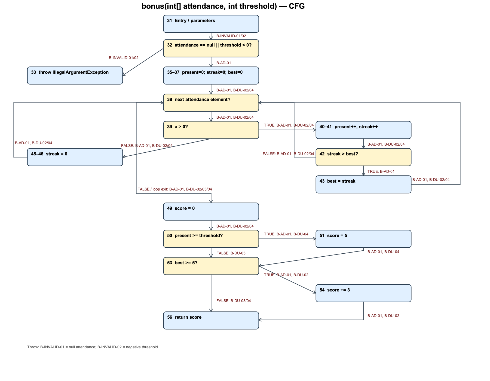

# Лаборатори №10 — Өгөгдлийн урсгалын тест (Definition–Use pairs)

## Оюутан ба орчин

- Нэр: **Ундрах**
- Код: **B252270135**
- `java -version`: `openjdk version "25.0.2" 2026-01-20 LTS`
- `mvn -version`: `Apache Maven 3.10.0`; Maven runtime Java `27.0.1.0.3`
- Starter Java compile target: `17`
- JUnit Jupiter `5.10.2`; JaCoCo `0.8.12`.
- PMD `7.14.0`; M3 static analysis-г Java `25.0.2` runtime дээр ажиллуулсан.

## Starter

`src/main/java/mn/edu/must/sqat/DataFlowTargets.java` файлыг starter.zip-ээс өөрчлөлгүй оруулсан. `mvn verify`-г эхлүүлж starter төслийн `BUILD SUCCESS`-ийг `results/mvn-verify-starter.txt`-д хадгалсан.

## A. `gcd` — бүх DU хос

CFG-ийн товчлол: 13-д `x`, `y` параметрүүд тодорхойлогдоно; 15 нь `y != 0` predicate; 16-д `tmp` тодорхойлогдож `x`,`y`-г c-use хийнэ; 17-д `x` шинэчлэгдэнэ; 18-д `y` шинэчлэгдэнэ; 20-д `x` буцаагдана. Def-clear гэдэг нь def мөрөөс use хүртэлх замд тухайн хувьсагч дахин тодорхойлогдохгүй байхыг хэлнэ.

| Хувьсагч | Def мөр | Use мөр | Use төрөл | Def-clear зам | Тестийн ID | Хамрагдсан |
|---|---:|---:|---|---|---|---|
| x | 13 | 16 | c-use | 13→15(T)→16 | GCD-01 | Тийм |
| x | 13 | 20 | c-use | 13→15(F)→20 | GCD-02 | Тийм |
| x | 17 | 16 | c-use | 17→18→15(T)→16 | GCD-01 | Тийм |
| x | 17 | 20 | c-use | 17→18→15(F)→20 | GCD-01 | Тийм |
| y | 13 | 15 | p-use | 13→15(F) | GCD-02 | Тийм |
| y | 13 | 15 | p-use | 13→15(T)→16→17→18→15 | GCD-01 | Тийм |
| y | 13 | 16 | c-use | 13→15(T)→16 | GCD-01 | Тийм |
| y | 18 | 15 | p-use | 18→15(T) | GCD-01 | Тийм |
| y | 18 | 15 | p-use | 18→15(F) | GCD-01 | Тийм |
| y | 18 | 16 | c-use | 18→15(T)→16 | GCD-01 | Тийм |
| tmp | 16 | 18 | c-use | 16→17→18 | GCD-01 | Тийм |

Хүснэгт дэх мөрийн дугаарууд нь starter файлын өөрчлөгдөөгүй бодит мөрүүд. `GCD-01` олон давталттай замаар loop доторх def-үүдийг, `GCD-02` тэг давталтын parameter-use замыг хамарна.

## B. `bonus` — def/use жагсаалт ба DU analysis

### B2. Мөр бүрийн def/use жагсаалт

| Мөр | Def | Use (төрөл) |
|---:|---|---|
| 31 | `attendance`, `threshold` параметрүүд | — |
| 32 | — | `attendance` (p-use), `threshold` (p-use; `attendance != null` үед) |
| 33 | — | — |
| 35 | `present` | — |
| 36 | `streak` | — |
| 37 | `best` | — |
| 38 | `a` (давталтын утга) | `attendance` (p-use: дараагийн элемент байгаа эсэх) |
| 39 | — | `a` (p-use: true болон false үр дүн) |
| 40 | `present` | `present` (c-use, `present + 1`) |
| 41 | `streak` | `streak` (c-use, `streak + 1`) |
| 42 | — | `streak` (p-use), `best` (p-use) |
| 43 | `best` | `streak` (c-use) |
| 45 | — | — |
| 46 | `streak` | — |
| 48 | — | — |
| 49 | `score` | — |
| 50 | — | `present` (p-use), `threshold` (p-use) |
| 51 | `score` | — |
| 53 | — | `best` (p-use) |
| 54 | `score` | `score` (c-use, `score + 3`) |
| 56 | — | `score` (c-use, return) |

### B3. Def-clear DU хосууд

| Хувьсагч | Def мөр | Use мөр | c-use / p-use | Def-clear зам | Тестийн ID |
|---|---:|---:|---|---|---|
| attendance | 31 | 32 | p-use | 31→32 | B-AD-01, B-INVALID-01 |
| attendance | 31 | 38 | p-use | 31→32(false)→35→38 | B-AD-01, B-DU-03 |
| threshold | 31 | 32 | p-use | 31→32 (attendance null биш үед) | B-INVALID-02, B-AD-01 |
| threshold | 31 | 50 | p-use | 31→32(false)→35→38→49→50 | B-AD-01, B-DU-02/03 |
| present | 35 | 40 | c-use | 35→38→40 | B-AD-01 |
| present | 35 | 50 | p-use | 35→38(false)→49→50 | B-DU-02/03 |
| present | 40 | 40 | c-use | 40→41→42→38→39→40 | B-AD-01 |
| present | 40 | 50 | p-use | 40→…→38(false)→49→50 | B-AD-01, B-DU-02 |
| streak | 36 | 41 | c-use | 36→37→38→39(true)→40→41 | B-AD-01 |
| streak | 41 | 41 | c-use | 41→42→38→39(true)→40→41 | B-AD-01 |
| streak | 41 | 42 | p-use | 41→42 | B-AD-01, B-DU-02 |
| streak | 46 | 41 | c-use | 46→38→39(true)→40→41 | B-AD-01 |
| best | 37 | 42 | p-use | 37→38→39(true)→40→41→42 | B-AD-01 |
| best | 37 | 53 | p-use | 37→…→38(false)→49→50→53 | B-AD-01, B-DU-02/03 |
| best | 43 | 42 | p-use | 43→38→39(true)→40→41→42 | B-AD-01 |
| best | 43 | 53 | p-use | 43→…→38(false)→49→50→53 | B-AD-01 |
| score | 49 | 54 | c-use | 49→50(false)→53(true)→54 | B-DU-02 |
| score | 49 | 56 | c-use | 49→50(false)→53(false)→56 | B-DU-03 |
| score | 51 | 54 | c-use | 51→53(true)→54 | B-AD-01 |
| score | 51 | 56 | c-use | 51→53(false)→56 | B-DU-04 |
| score | 54 | 56 | c-use | 54→56 | B-AD-01 |
| a | 38 | 39 (true) | p-use | 38→39(true) | B-AD-01, B-DU-02 |
| a | 38 | 39 (false) | p-use | 38→39(false) | B-AD-01, B-DU-02 |

`streak = 0` гэсэн мөр 46 def нь тухайн хувьсагчийн өмнөх мөр 36 эсвэл 41-ийн def-үүдийг **kill** хийнэ. Мөр 46-ын def-ээс дараагийн хэрэглээнд хүрэхийн тулд давталт дахин эерэг утга уншиж мөр 41-ийн RHS-ийг ашиглах зам (`46→38→39(true)→40→41`) шаардлагатай; мөр 42-ын predicate хүрэхээс өмнө мөр 41 дахин def хийдэг.

### B1. Bonus CFG

Зангилаанууд starter файлын мөрийн дугаартай; ирмэгүүдэд түүгээр дайрах тестийн ID тэмдэглэсэн.



### B4. ALL-DEFS шат

`B-AD-01` нь non-exceptional нөхцөлөөр `present`, `streak`, `best`, `a`, `score` хувьсагчдын бүх executable definition-ийг дор хаяж нэг use-д хүргэнэ. Нэг тестээр хангах боломжтой тул энэ шатны bonus тестийн хамгийн бага тоо **1**. `mvn clean verify -Dtest='GcdTest,BonusTest#allDefinitionsAreReachedByOneInput'` гаралт болон JaCoCo CSV-г `results/mvn-verify-alldefs.txt`, `results/jacoco-alldefs.csv`-д хадгална.

Энэ шатны run нь GCD-ийн 2 тест болон bonus-ийн `B-AD-01` гэсэн 1 тест ажиллуулж, **3 тест, 0 failure/error** гаргасан. JaCoCo class row: **12/16 branches**, 22/24 lines; ALL-DEFS нь branch coverage-тэй адил шалгуур биш тул ALL-DU-PAIRS шатанд нэмэлт замууд орно.

### B4. ALL-DU-PAIRS шат

`BonusTest` одоо `B-AD-01` дээр нэмээд DU хүснэгтийн бүх замд хүрэх 5 тест агуулна: `B-DU-02` score-ийн def-to-use хоёр зам болон fragmented streak; `B-DU-03` хоосон массив/score буцах зам; `B-DU-04` threshold хангаж байгаа ч streak < 5 зам; `B-INVALID-01/02` null attendance болон сөрөг threshold. GCD-ийн 2 тесттэй нийлээд бүх suite **8 тест** ажиллуулна. `mvn clean verify`-ийн JaCoCo үр дүн class row дээр **BRANCH_MISSED=0, BRANCH_COVERED=16** болохыг эцсийн CSV-ээр батална.

## C. Fault seeding үр дүн

Мутаци бүрийг тусад нь оруулж `mvn test` ажиллуулаад `git restore`-оор starter эх кодыг шууд буцаасан. Эцсийн `DataFlowTargets.java` өөрчлөгдөөгүй.

| Fault | Үр дүн | Гаралтын файл |
|---|---|---|
| M1 — `streak = streak + 1` мөрийг хасах | **Баригдсан:** all-defs болон streak-dependent тестүүд унана; `BUILD FAILURE`, exit 1 | `results/mvn-test-M1.txt` |
| M2 — `best = streak` → `best = present` | Эхний тестийн багцад амьд үлдсэн (`BUILD SUCCESS`); `B-DU-04`-ийг `[1,0,1,1,1,1,0]`, threshold 5 гэж сонгож нэмсний дараа **баригдсан**, нэг failure, exit 1 | `results/mvn-test-M2.txt`, `results/mvn-test-M2-kill.txt` |
| M3 — ашиглагдахгүй `int total = present + best;` тодорхойлолт нэмэх | Unit тестүүд **8/8 PASS**, exit 0. PMD-ийн `UnusedLocalVariable` дүрэм `total`-ийг 49-р мөрөнд илрүүлж `pmd:check`-ийг нэг violation-оор унагасан | `results/mvn-test-M3.txt`, `results/pmd-M3.txt`, `results/pmd-M3.xml` |

PMD-г дахин шалгахдаа fault түр идэвхтэй байхад дараах командыг ажиллуулна:

```sh
JAVA_HOME="/Library/Java/JavaVirtualMachines/jdk-25.jdk/Contents/Home" \
  PATH="/Library/Java/JavaVirtualMachines/jdk-25.jdk/Contents/Home/bin:$PATH" \
  mvn pmd:check
```

Final restore-ийн дараа `mvn clean verify` ногоон болсон; `results/mvn-verify-final.txt`, `results/jacoco-final.csv` нь эх код сэргээсэн эцсийн төлөвийг харуулна.

## Дүгнэлт

1. Def/use хүснэгт нь хувьсагч хаана утга авч, хаана predicate эсвэл тооцоонд хэрэглэгдэж байгааг мөрөөр нь холбосон.
2. GCD-ийн хоёр тест loop body хэрэгжих болон хоосон loop exit замын бүх DU хосыг хамарсан.
3. Bonus-ийн нэг `B-AD-01` тест executable definition бүрд хүрсэн тул all-defs-ийн хамгийн бага тоо нэг болов.
4. Нэмэлт bonus тестүүд score-ийн c-use болон predicate use-ийн өөр өөр def-clear замыг ялгаж шалгасан.
5. Мөр 46 дээрх `streak=0` нь өмнөх streak def-үүдийг kill хийж, дараагийн streak тооцоог тасалдаг.
6. Бүрэн suite 8 тестээр JaCoCo-ийн 16 branch бүгдийг хамарсан.
7. M1 missing update алдааг streak-ийн хүлээгдэх оноо өөрчлөгдсөнөөр тестүүд барьсан.
8. M2 эхэндээ амьд үлдсэн тул төлөөлөх input-ийг шинэчилсний дараа mutation-ийн нөлөөг онооны босгон дээр ялгаж барьсан.
9. M3-ийн dead definition нь runtime behavior-д нөлөөлөөгүй ч PMD-ийн unused-local-variable шинжилгээгээр илэрсэн.
